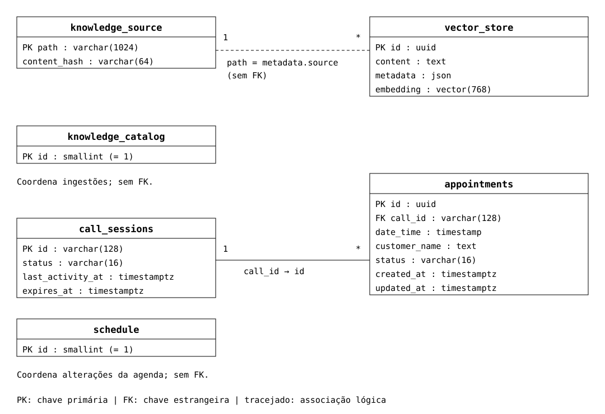

# Icety — agendamento por voz

Simulação local de atendimento de uma clínica. Você fala pelo navegador, a aplicação transcreve o áudio, consulta documentos ou opera a agenda e responde com texto e voz.

O processamento usa **Ollama, faster-whisper e Piper**, sem chave nem cobrança de API. Os documentos de demonstração contêm informações fictícias. A integração com telefonia ainda não foi implementada.

## Subir a aplicação

Requisitos: Java 21 e Docker com Compose. Execute na raiz do projeto.

Na primeira configuração:

```bash
cp .env.example .env
```

Preencha `DB_PASSWORD` no `.env` e habilite o áudio com `VOICE_ENABLED=true`. Não versione sua senha. Se a porta 5432 já estiver ocupada, ajuste as duas variáveis:

```properties
DB_PORT=5433
DB_URL=jdbc:postgresql://localhost:5433/icety
```

Suba os serviços e baixe os modelos:

```bash
docker compose --profile voice up -d --build --wait postgres ollama audio
docker compose exec ollama ollama pull qwen2.5:7b
docker compose exec ollama ollama pull nomic-embed-text
./mvnw spring-boot:run
```

O modelo de conversa ocupa aproximadamente 4,7 GB e o de busca, 274 MB. O serviço de áudio também baixa seus modelos na primeira inicialização. Os volumes Docker preservam os dados e modelos para as próximas execuções.

Para subir novamente, basta executar o comando do Compose e `./mvnw spring-boot:run`; não é necessário baixar novamente os modelos já presentes.

Abra [a simulação de voz](http://localhost:8080/voice.html) no Chrome/Chromium, permita o microfone e siga:

1. Clique em **Ligar**.
2. Clique em **Gravar**, faça a pergunta e clique em **Enviar fala**.
3. Aguarde a resposta antes de enviar a próxima fala.
4. Clique em **Desligar** ao terminar.

Cada gravação pode ter até 30 segundos. Para interromper a reprodução, clique em **Gravar** novamente. Isso para a voz, mas não desfaz uma operação já executada na agenda.

## O que perguntar

Comece pelas informações presentes nos documentos:

| Pergunta | De onde vem a informação |
| --- | --- |
| “Qual é o horário de atendimento?” | `knowledge/horario-atendimento.md`: segunda a sexta, das 8h às 18h |
| “Vocês atendem aos domingos?” | Documento de exemplo e regra de dias fechados |
| “Que tipo de consulta vocês oferecem?” | `knowledge/example.md`: clínica geral |
| “O que preciso levar na primeira consulta?” | `knowledge/example.md`: documento de identificação e exames anteriores |

Para experimentar a agenda, use uma data futura e um horário específico, com início em `:00` ou `:30`:

- **Consultar:** “Há disponibilidade no dia [data] às 10h?”
- **Reservar:** “Quero marcar uma consulta no dia [data] às 10h.”
- **Confirmar, depois de receber a reserva:** “Meu nome é Ana e confirmo esse horário.”
- **Liberar, antes de confirmar:** “Quero cancelar essa reserva temporária.”

Uma reserva temporária ainda não é uma consulta confirmada. Ela exige nome e confirmação explícita. A disponibilidade depende dos registros existentes; os exemplos não garantem uma vaga.

**Limitações atuais:** a aplicação consulta um horário específico, mas não tem uma ferramenta que liste todos os horários livres de um dia. “Quais são os horários disponíveis?” ainda não tem esse suporte. Algumas falhas de reserva recebem uma mensagem genérica que não distingue a causa. O modelo também pode interpretar uma fala incorretamente.

## Documentos: como ensinar informações ao atendimento

Crie arquivos `.md` ou `.txt` em `knowledge/`. Use-os para endereço, serviços, horário de atendimento e orientações. Mantenha uma informação consistente entre os arquivos; documentos contraditórios podem confundir a resposta.

Exemplo já incluído em [horario-atendimento.md](knowledge/horario-atendimento.md):

> A clínica atende de segunda a sexta-feira, das 08h às 18h, no horário local de Fortaleza.

Ao iniciar o backend, os documentos são indexados automaticamente. Para atualizar o banco com o backend já rodando, execute em outro terminal:

```bash
./mvnw spring-boot:run -Dspring-boot.run.profiles=ingest
```

Esse comando atualiza os documentos e encerra, sem abrir outro servidor HTTP. O log mostra quantos arquivos foram atualizados, preservados ou removidos. Não é necessário reiniciar o atendimento depois da ingestão.

A aplicação divide os arquivos em trechos de aproximadamente 500 tokens e gera um **embedding**: uma representação numérica que permite buscar textos de significado parecido. A pergunta também vira um embedding; os trechos relacionados são entregues ao modelo para compor a resposta. Esse processo é chamado de **RAG**.

Arquivos iguais não são processados novamente. Alterações substituem os trechos antigos; arquivos removidos são retirados do índice na próxima ingestão. Uma pasta válida vazia remove todos os documentos indexados. Uma falha durante a ingestão preserva o índice anterior.

**Documentos não guardam vagas disponíveis nem impõem regras à agenda.** O horário descrito acima orienta a resposta, mas ainda não bloqueia reservas fora das 8h–18h. Atualmente, o bloqueio de dias é definido em `SCHEDULE_CLOSED_DAYS`, com domingo fechado por padrão. As consultas duram 30 minutos. Não há cancelamento de agendamento já confirmado.

## Modelagem do banco



Os nomes reais são **`vector_store`**, **`knowledge_source`** e **`knowledge_catalog`**, no singular.

| Tabela | O que guarda e para que serve |
| --- | --- |
| **`vector_store`** | Cada linha é um trecho de documento: `content` guarda o texto, `embedding` guarda o vetor de 768 dimensões e `metadata` identifica o arquivo de origem e a posição do trecho. É a tabela consultada na busca por significado. |
| **`knowledge_source`** | Um registro por arquivo, com seu caminho e uma assinatura do conteúdo (`content_hash`). Permite detectar alterações e evitar gerar novamente embeddings de arquivos iguais. |
| **`knowledge_catalog`** | Um único registro, com `id = 1`, usado para coordenar ingestões concorrentes. Não guarda documentos, textos ou embeddings. |
| `call_sessions` | Identificador, estado e validade de cada ligação. O navegador envia sinais periódicos para mantê-la ativa. |
| `appointments` | Horário, nome e estado da reserva ou consulta. Cada registro pertence a uma ligação. |
| `schedule` | Um único registro usado para coordenar alterações simultâneas na agenda. Não é uma lista de horários de funcionamento ou vagas. |

A seta contínua da imagem representa a chave estrangeira `appointments.call_id → call_sessions.id`. A linha tracejada entre documentos e trechos representa uma **associação pelos metadados**, sem chave estrangeira: `vector_store.metadata.source` contém o caminho de `knowledge_source.path`. Um arquivo pode gerar vários trechos.

As tabelas `knowledge_catalog` e `schedule` coordenam operações, cada uma em seu fluxo; não possuem chaves estrangeiras para as demais tabelas.

Para visualizar os trechos no seu cliente SQL:

```sql
SELECT id, content,
       metadata->>'source' AS arquivo,
       metadata->>'chunk' AS trecho
FROM vector_store
ORDER BY arquivo, trecho;

SELECT path, content_hash FROM knowledge_source;
SELECT * FROM knowledge_catalog;
SELECT id, call_id, date_time, customer_name, status FROM appointments;
```

As migrations em `src/main/resources/db/migration/` criam e atualizam essas tabelas automaticamente. O volume `postgres_data` preserva os dados após reiniciar o serviço.

## Quem faz o quê e por que pode demorar

**Microfone → faster-whisper → Java + Ollama + PostgreSQL → Piper → alto-falante.**

- **faster-whisper:** transcreve a gravação para texto.
- **Ollama:** gera embeddings, interpreta a mensagem e produz respostas usando os modelos configurados.
- **Java:** valida regras e executa as ferramentas de consulta, reserva, confirmação e liberação.
- **PostgreSQL com pgvector:** guarda a agenda e os trechos dos documentos.
- **Piper:** transforma a resposta escrita em voz.

Essas etapas acontecem em sequência. O Qwen 7B em CPU pode demorar, e uma fala pode exigir mais de uma chamada ao modelo. Há uma interpretação adicional quando o modelo não tenta executar uma operação de alteração; ela também pode ocorrer em perguntas informativas. O WebSocket transporta texto e áudio, mas isso ainda não é uma conversa contínua de baixa latência.

O código Java garante as regras da agenda. As ferramentas acessam a mesma validação dos endpoints; documentos ou pedidos do usuário não podem liberar um dia configurado como fechado. As mensagens de reserva e confirmação são formadas a partir do resultado da operação no banco.

A ligação vence após dois minutos sem sinais de atividade. Encerrar libera reservas temporárias e preserva consultas confirmadas. Cada fala tem supervisão de dois minutos; se exceder esse limite, a conexão pode ser encerrada. A mensagem de encerramento atual pode esconder o erro que iniciou a desconexão.

## Referência técnica

O projeto usa Java, Spring Boot, Spring AI e arquitetura hexagonal: regras no domínio, coordenação nos casos de uso e integrações nos adaptadores. A decisão sobre reservas está na [ADR 0001](docs/adr/0001-agendamentos-e-reservas-temporarias.md).

### Endpoints principais

| Método e rota | Uso |
| --- | --- |
| `POST /api/calls` | Inicia uma ligação com `{"callId":"ligacao-001"}` |
| `POST /api/calls/{callId}/heartbeat` | Mantém a ligação ativa; envie a cada 30 segundos por padrão |
| `POST /api/calls/{callId}/messages` | Atendimento por texto, com `{"text":"Qual é o horário de atendimento?"}`; retorna `reply` |
| `POST /api/calls/{callId}/end` | Encerra a ligação |
| `GET /api/appointments/availability?dateTime=...` | Consulta uma data/hora local ISO, como `2026-12-01T10:00:00` |
| `POST /api/appointments/reservations` | Reserva com `callId` e `dateTime` |
| `POST /api/appointments/{id}/confirm` | Confirma com `callId` e `customerName` |
| `POST /api/appointments/{id}/release` | Libera a temporária com `callId` |
| `POST /api/appointments/parse` | Extrai campos de `text`; não consulta nem altera a agenda |
| `GET /api/voice/status` | Informa se a voz está habilitada |
| `WS /api/calls/{callId}/voice` | Canal de voz da ligação |

O histórico da conversa fica em memória, por ligação; reiniciar o backend apaga esse histórico, mas preserva a agenda e os documentos no banco.

### Configuração e operação

As variáveis disponíveis estão em [.env.example](.env.example). O Spring lê o `.env` da raiz; variáveis exportadas no ambiente têm precedência. Nunca versione credenciais.

| Variável | Uso / padrão |
| --- | --- |
| `OLLAMA_MODEL` | Modelo de conversa: `qwen2.5:7b` |
| `OLLAMA_EMBEDDING_MODEL` | Modelo de busca: `nomic-embed-text`, 768 dimensões |
| `KNOWLEDGE_DIRECTORY` | Pasta documental: `knowledge` |
| `KNOWLEDGE_INGEST_ON_STARTUP` | Ingestão ao iniciar: `true` |
| `SCHEDULE_CLOSED_DAYS` | Dias fechados: `SUNDAY`; exemplo: `SATURDAY,SUNDAY` |
| `VOICE_ENABLED` | Habilita voz; padrão `false`, use `true` para a simulação |
| `VOICE_TIMEOUT` | Tempo limite das operações de áudio: `60s` |
| `WHISPER_MODEL` | Transcrição: `small` |
| `PIPER_VOICE` | Voz: `pt_BR-faber-medium` |

Não mude o modelo de embeddings sem planejar a reindexação: ingestão e busca precisam usar o mesmo modelo. Vetores de outras dimensões exigem alteração do banco.

```bash
# Conferir os serviços
docker compose --profile voice ps

# Parar a infraestrutura sem apagar volumes
docker compose --profile voice stop
```

O backend executado no terminal é encerrado com Ctrl+C. As portas padrão são 8080 (backend), 11434 (Ollama), 8090 (áudio) e 5432 (PostgreSQL, ajustável no .env).

### Comandos de testes para o desenvolvedor

```bash
./mvnw test
./mvnw -Plocal-ai verify
```

O primeiro usa serviços de IA simulados e banco descartável via Testcontainers; exige Docker. O segundo também avalia o Ollama real e pode demorar ou falhar por interpretação do modelo. Nenhum desses resultados garante a qualidade de toda conversa por voz. A simulação manual é feita na página do navegador.
